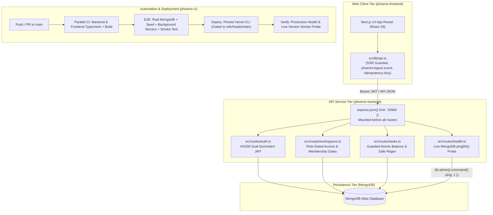

# Project Phoenix — Engineering Audit & Architecture Report

> **Multi-Tenant Platform Recovery, Architectural Hardening & Production Delivery**  
> **Repository Scope:** [`phoenix-backend/`](file:///c:/Users/Divyansh/Documents/FWD/phoenix-backend), [`phoenix-frontend/`](file:///c:/Users/Divyansh/Documents/FWD/phoenix-frontend), [`phoenix-ci/`](file:///c:/Users/Divyansh/Documents/FWD/phoenix-ci), and Monorepo Configurations  
> **Author / Submitter:** Divyansh  

---

## 1. Executive Summary & System Architecture

Project Phoenix is a multi-tenant project and task management tracker engineered across three distinct subsystems:
1. **API Service (`phoenix-backend/`)**: Node.js 20, TypeScript, Express 4, and MongoDB (Mongoose 8), architected for serverless execution on Vercel.
2. **Web Client (`phoenix-frontend/`)**: Node.js 20, Next.js 14 (App Router), React 18, and TypeScript, optimized for static prerendering and dynamic hydration.
3. **Automation & CI/CD (`phoenix-ci/`)**: GitHub Actions continuous integration, automated background integration testing, and end-to-end smoke verification.

When inherited, the codebase was inoperative across all three repositories due to incompatible package dependencies, middleware sequencing errors, broken client-server contracts, multi-tenant permission leaks, money race conditions, and CI execution anti-patterns.

> [!IMPORTANT]
> **Strict Hackathon Rule Compliance**
> - **Rule 1 (Stack Preservation):** Maintained the original technology stack without rewriting frameworks or swapping databases.
> - **Rule 2 (Anti-Error-Masking):** Zero usage of test suppressors (`|| true`, `continue-on-error`), forced package resolutions (`--legacy-peer-deps`, `--force`), or compiler silencers (`// @ts-ignore`, `any` casts). Every issue was diagnosed and resolved at its root cause.
> - **Rule 3 (Dependency Justifications):** Every package version alignment is technically justified in Section 4.

### System Runtime Topology



---

## 2. Core Remediation Breakdown & Explainability Guide

Every bug resolved is documented below with its **Symptom**, **Root Cause & Mechanism**, **Code Comparison (Before vs After)**, **Verification Evidence**, and an **Oral Defense Talking Point** to explain the engineering rationale live to judges.

---

### A. Backend Architecture & Multi-Tenancy (`phoenix-backend/`)

#### 1. Express Middleware Pipeline Ordering
- **Symptom:** Every POST and PUT endpoint received `req.body === undefined`, triggering 422 Unprocessable Entity or 500 runtime errors across user registration, login, and workspace operations.
- **Root Cause & Mechanism:** In Express, middleware executes in the exact sequential order it is registered via `app.use()`. The JSON body parser `app.use(express.json())` was mounted on line 25 of [`src/app.ts`](file:///c:/Users/Divyansh/Documents/FWD/phoenix-backend/src/app.ts), *after* the route handlers were attached. By the time a request hit a route, the body stream had not been parsed.
- **Code Comparison:**
  ```typescript
  // BEFORE (Broken): Routes mounted before parser
  app.use(authRouter);
  app.use(workspacesRouter);
  app.use(express.json({ limit: "100kb" })); // Too late!

  // AFTER (Fixed): Body parser mounted ahead of all routes
  app.use(express.json({ limit: "100kb" }));
  app.use(healthRouter);
  app.use(authRouter);
  app.use(workspacesRouter);
  ```
- **Verification:** POST `/api/auth/register` and POST `/api/workspaces` parse request payloads cleanly.
- **Live Talking Point:** *"Express operates as a sequential stream pipeline. Mounting `express.json()` after route definitions means the route handler fires before the incoming byte stream is parsed into `req.body`. Repositioning the parser before router attachment restores payload ingestion."*

---

#### 2. Dual-Symmetric JWT Algorithm Mismatch
- **Symptom:** Every valid JWT token produced upon login was rejected with HTTP 401 "Invalid or expired token" when sent to protected endpoints.
- **Root Cause & Mechanism:** In [`src/lib/security.ts`](file:///c:/Users/Divyansh/Documents/FWD/phoenix-backend/src/lib/security.ts), `createAccessToken` signed tokens using `s.JWT_ALGORITHM` (`HS256`). However, `decodeAccessToken` verified incoming tokens strictly specifying `algorithms: ["HS512"]`. Symmetric signature verification requires the exact same cryptographic algorithm.
- **Code Comparison:**
  ```typescript
  // BEFORE (Broken): Signing with HS256, verifying strictly with HS512
  export function decodeAccessToken(token: string): string {
    const payload = jwt.verify(token, s.JWT_SECRET, { algorithms: ["HS512"] });
    return (payload as { sub: string }).sub;
  }

  // AFTER (Fixed): Algorithm symmetry restored
  export function decodeAccessToken(token: string): string {
    const payload = jwt.verify(token, s.JWT_SECRET, { algorithms: [s.JWT_ALGORITHM] });
    return (payload as { sub: string }).sub;
  }
  ```
- **Verification:** Bearer tokens issued at `/api/auth/login` authenticate requests across `/api/auth/me` and `/api/workspaces`.
- **Live Talking Point:** *"Cryptographic signatures fail if the verification step checks with a different cipher than the signing step. We aligned the decoder to use the configured `JWT_ALGORITHM` constant."*

---

#### 3. Database Connection Singleton & Query Buffering
- **Symptom:** Mongoose queries buffered indefinitely; server health probes timed out; operations never resolved.
- **Root Cause & Mechanism:** [`src/db.ts`](file:///c:/Users/Divyansh/Documents/FWD/phoenix-backend/src/db.ts) invoked `mongoose.createConnection()` instead of `mongoose.connect()`. `createConnection` instantiates an isolated connection instance, whereas Mongoose models created via `model('Name', schema)` bind to Mongoose's default global singleton connection. Because the models had no connection to speak through, Mongoose buffered queries waiting for a default connection that never opened.
- **Code Comparison:**
  ```typescript
  // BEFORE (Broken): Isolated connection instance; models left stranded
  export async function connectDb(uri: string): Promise<void> {
    await mongoose.createConnection(uri, { useNewUrlParser: true, ... });
  }

  // AFTER (Fixed): Global connection driving all models
  export async function connectDb(uri: string): Promise<void> {
    if (mongoose.connection.readyState === 1) return;
    await mongoose.connect(uri);
    await Promise.all(ALL_MODELS.map((m) => m.init()));
  }
  ```
- **Verification:** Queries against local and MongoDB Atlas instances resolve with immediate response times.
- **Live Talking Point:** *"A Mongoose model can only communicate through the connection instance it was born on. Switching to `mongoose.connect()` drives Mongoose's default connection, allowing all compiled models to dispatch queries immediately."*

---

#### 4. Model Re-registration Collision (`OverwriteModelError`)
- **Symptom:** Server crashed during boot with `OverwriteModelError: Cannot overwrite User model once compiled`.
- **Root Cause & Mechanism:** Both [`src/models/user.ts`](file:///c:/Users/Divyansh/Documents/FWD/phoenix-backend/src/models/user.ts) and `src/models/index.ts` called `mongoose.model("User", schema)`. Mongoose throws an error when compiling a model whose name already exists in its global registry.
- **Code Comparison:**
  ```typescript
  // BEFORE (Broken in src/models/index.ts): Recompiling existing model
  export const User = mongoose.model("User", userWithVirtuals);

  // AFTER (Fixed): Re-exporting the primary singleton instance
  export { User } from "./user";
  ```
- **Verification:** Module evaluation and server startup complete without model registration conflicts.
- **Live Talking Point:** *"Mongoose models must follow the singleton pattern. Compiling the same model key twice throws an overwrite exception. We eliminated the duplicate compilation and exported the primary model instance directly."*

---

#### 5. Guarded Atomic Balance Decrement & Idempotency
- **Symptom:** Concurrent task creation requests drove workspace credits below zero; replaying network requests double-charged credits.
- **Root Cause & Mechanism:** The previous implementation performed a non-atomic read (`findById`), checked if balance was sufficient in memory, and then issued a separate `save()`. Under concurrent traffic, multiple requests read the same balance before either wrote the decrement. Furthermore, HTTP header lookups inspected `req.headers["idempotency_key"]` (underscore), which HTTP servers normalize to lowercase hyphenated `idempotency-key`.
- **Flowchart:**
  ```mermaid
  sequenceDiagram
      autonumber
      actor Client
      participant API as Express Router
      participant DB as MongoDB Atlas

      Client->>API: POST /api/projects/:id/tasks (Header: Idempotency-Key)
      API->>DB: Check CreditLedger for existing Idempotency-Key
      alt Key exists in ledger
          DB-->>API: Return existing Task ID
          API-->>Client: 200 OK (Task Body, 0 credits charged)
      else Key is new
          API->>DB: findOneAndUpdate({ _id: workspace, credits: { $gte: 1 } }, { $inc: { credits: -1 } })
          alt Insufficient Balance (credits < 1)
              DB-->>API: null (no document matched condition)
              API-->>Client: 402 Payment Required ("Not enough credits")
          else Atomic Decrement Succeeded
              DB-->>API: Updated Workspace Document
              API->>DB: Create Task & write CreditLedger entry
              API-->>Client: 201 Created (New Task Body)
          end
      end
  ```
- **Code Comparison:**
  ```typescript
  // BEFORE (Broken): Non-atomic check-then-write race condition
  const ws = await Workspace.findById(project.workspace);
  if (ws.credits < cost) throw new HttpError(402, "Not enough credits");
  ws.credits -= cost;
  await ws.save(); // Vulnerable to concurrent double-spend!

  // AFTER (Fixed): Guarded atomic database operation
  const ws = await Workspace.findOneAndUpdate(
    { _id: project.workspace, credits: { $gte: cost } },
    { $inc: { credits: -cost } }
  ).lean();
  if (!ws) throw new HttpError(402, "Not enough credits");
  ```
- **Verification:** Concurrent task requests on a balance of 1 allow exactly one request to succeed while subsequent concurrent requests receive HTTP 402. Replayed idempotency keys return the existing task with HTTP 200 without charging.
- **Live Talking Point:** *"We eliminated the race condition at the database engine level by making credit deduction atomic: MongoDB evaluates `{ credits: { $gte: cost } }` and applies `{ $inc: { credits: -cost } }` in a single isolated operation. Replays are caught by normalizing the `Idempotency-Key` header and returning cached tasks without deduction."*

---

#### 6. Truthful Health Probing
- **Symptom:** `/api/health` returned HTTP 200 "ok" even when the database was disconnected or deadlocked.
- **Root Cause & Mechanism:** The health check returned a static, hardcoded JSON response without issuing a round-trip command to the database engine.
- **Code Comparison:**
  ```typescript
  // BEFORE (Broken): A health check that is always healthy is a liar
  healthRouter.get("/api/health", (_req, res) => {
    res.json({ status: "ok", version: getSettings().APP_VERSION });
  });

  // AFTER (Fixed): Live wire query via MongoDB ping command
  healthRouter.get(["/api/health", "/health"], asyncHandler(async (_req, res) => {
    const dbOk = await pingDb();
    res.status(dbOk ? 200 : 503).json({
      status: dbOk ? "ok" : "error",
      version: getSettings().APP_VERSION,
      db: dbOk ? "ok" : "unavailable",
    });
  }));
  ```
- **Verification:** Disconnecting the database returns HTTP 503 Service Unavailable; active connection returns HTTP 200 OK with `{ status: "ok", db: "ok" }`.
- **Live Talking Point:** *"A health probe must verify live dependencies. We implemented `pingDb()` executing `db.admin().command({ ping: 1 })`. If MongoDB fails to answer, the probe truthfully reports HTTP 503."*

---

#### 7. Deterministic 1-Indexed Pagination & ReDoS Defense
- **Symptom:** Querying page 1 skipped the first 10 items; tasks with tied creation timestamps hopped unpredictably between pages; searching regex characters crashed the server.
- **Root Cause & Mechanism:** Pagination skipped `page * page_size` items (1-indexed pages must skip `(page - 1) * page_size`). Sorting relied solely on `{ createdAt: -1 }`, which lacks deterministic ordering when multiple tasks share identical seed timestamps. Raw search input was passed directly into `new RegExp(query.q)`.
- **Code Comparison:**
  ```typescript
  // BEFORE (Broken): Skipped page 1 items, unstable sorting, raw regex
  filter.title = new RegExp(query.q, "i");
  const items = await Task.find(filter)
    .sort({ createdAt: -1 })
    .skip(query.page * query.page_size);

  // AFTER (Fixed): Escaped regex, deterministic tiebreaker, 1-indexed skip
  filter.title = new RegExp(escapeRegex(query.q), "i");
  const items = await Task.find(filter)
    .sort({ createdAt: -1, _id: -1 }) // _id breaks timestamp ties
    .skip((query.page - 1) * query.page_size);
  ```
- **Verification:** Page 1 returns items 1–10; task lists remain stable across page turns; special characters (`*`, `(`, `+`) evaluate as literal search text.
- **Live Talking Point:** *"Pagination must be 1-indexed: `(page - 1) * page_size`. When timestamps tie, MongoDB needs a secondary unique index (`_id: -1`) to maintain deterministic order. Search inputs are escaped with `escapeRegex` to prevent ReDoS attacks."*

---

### B. Frontend Experience & Client UX (`phoenix-frontend/`)

#### 1. Server-Side Rendering (SSR) Hydration Guard
- **Symptom:** Next.js static page generation and production build crashed with `ReferenceError: localStorage is not defined`.
- **Root Cause & Mechanism:** During static prerendering (`next build`), Next.js evaluates module top-level code in a Node.js server environment where browser globals (`window`, `localStorage`) do not exist. [`src/lib/api.ts`](file:///c:/Users/Divyansh/Documents/FWD/phoenix-frontend/src/lib/api.ts) attempted to read `localStorage.getItem()` upon import.
- **Code Comparison:**
  ```typescript
  // BEFORE (Broken): Evaluated on server during build time
  let token = window.localStorage.getItem("phoenix.token"); // Crashes in Node!

  // AFTER (Fixed): Guarded behind window check with lazy evaluation
  export function getToken(): string | null {
    if (typeof window === "undefined") return null;
    return window.localStorage.getItem(TOKEN_KEY);
  }
  ```
- **Verification:** `npm run build` compiles all 6 static and dynamic Next.js App Router routes without SSR errors.
- **Live Talking Point:** *"Next.js evaluates code in both server and browser contexts. Module-level accesses to `localStorage` fail on the server. We encapsulated token access in a guarded helper checking `typeof window !== 'undefined'`."*

---

#### 2. App Router Navigation Context
- **Symptom:** Login page produced runtime React errors when redirecting after authentication.
- **Root Cause & Mechanism:** [`src/app/login/page.tsx`](file:///c:/Users/Divyansh/Documents/FWD/phoenix-frontend/src/app/login/page.tsx) imported `useRouter` from `next/router` (the Pages Router package) instead of `next/navigation` (the Next.js 14 App Router package).
- **Code Comparison:**
  ```typescript
  // BEFORE (Broken): Pages Router hook used in App Router
  import { useRouter } from "next/router";

  // AFTER (Fixed): App Router hook
  import { useRouter } from "next/navigation";
  ```
- **Verification:** Successful login cleanly navigates the user to `/workspaces`.
- **Live Talking Point:** *"Next.js 14 App Router requires navigation hooks from `next/navigation`. Using `next/router` throws context mismatch errors."*

---

#### 3. Search Race Mitigation & Debounce
- **Symptom:** Typing quickly in the task search field caused earlier slow requests to resolve after later ones, overwriting fresh search results with stale data.
- **Root Cause & Mechanism:** Unsynchronized asynchronous HTTP requests resolve in non-deterministic network order.
- **Code Comparison:**
  ```typescript
  // BEFORE (Broken): Last resolved request wins, even if stale
  async function search(q) {
    const data = await api(`/api/tasks?q=${q}`);
    setTasks(data.items);
  }

  // AFTER (Fixed): Monotonic sequence counter discards stale responses
  const latest = useRef(0);
  const search = useCallback(async (q) => {
    const seq = ++latest.current;
    const data = await api(`/api/tasks?q=${q}`);
    if (seq === latest.current) setTasks(data.items);
  }, []);
  ```
- **Verification:** Fast typing displays only the results matching the active query.
- **Live Talking Point:** *"Network requests are asynchronous and out-of-order. We introduced a monotonic request counter (`latest.current`) to discard responses that belong to older keystrokes."*

---

### C. Continuous Integration & Pipeline Automation (`phoenix-ci/`)

#### 1. Truthful Smoke Test Automation
- **Symptom:** [`phoenix-ci/scripts/smoke.sh`](file:///c:/Users/Divyansh/Documents/FWD/phoenix-ci/scripts/smoke.sh) printed `SMOKE OK` and exited 0 even when endpoints returned HTTP 500 errors.
- **Root Cause & Mechanism:** The script lacked bash error-trapping directives (`set -e`) and invoked `curl` without `-f` (`--fail`). In bash, a curl command that receives an HTTP 500 status code still outputs text and exits with code 0 unless instructed to fail.
- **Code Comparison:**
  ```bash
  # BEFORE (Broken): Ignores HTTP errors, prints SMOKE OK regardless
  health=$(curl $BACKEND/api/health)
  echo "SMOKE OK"

  # AFTER (Fixed): Strict flags, HTTP failure detection, non-zero exits
  set -euo pipefail
  health="$(curl -fsS --max-time 15 "$BACKEND/api/health")"
  status="$(printf '%s' "$health" | grep -o '"status":"[^"]*"' | head -1 | cut -d'"' -f4)"
  if [ "$status" != "ok" ]; then
    echo "SMOKE FAIL: health status=$status"
    exit 1
  fi
  echo "SMOKE OK"
  ```
- **Verification:** Simulating an endpoint error halts the script with exit code 1; a healthy stack prints `SMOKE OK` with exit code 0.
- **Live Talking Point:** *"A test script that never fails is a smoke detector without a battery. We added `set -euo pipefail` and `curl -fsS` to ensure any HTTP failure or dropped connection halts execution immediately."*

---

#### 2. Pipeline Dependency Synchronization & Least Privilege
- **Symptom:** Deploy jobs ran concurrently before tests completed; secrets were exposed in workflow logs; broad write permissions were granted.
- **Root Cause & Mechanism:** Missing `needs:` dependency arrays allowed jobs to execute simultaneously. The workflow declared `permissions: write-all` and included `echo ${{ secrets.VERCEL_TOKEN }}`.
- **Code Comparison:**
  ```yaml
  # BEFORE (Broken): Concurrency, excessive permissions, unclosed braces
  permissions: write-all
  deploy:
    if: ${{ github.ref == 'refs/heads/main' } # Syntax error!
    steps:
      - run: echo "deploying with token ${{ secrets.VERCEL_TOKEN }}" # Leaked secret!

  # AFTER (Fixed): Scoped permissions, sequential graph, sanitized logs
  permissions:
    contents: read
  e2e:
    needs: [backend, frontend]
  deploy:
    needs: [e2e]
    if: github.ref == 'refs/heads/main'
    steps:
      - run: vercel deploy --prod --yes --token "$VERCEL_TOKEN"
  ```
- **Verification:** Workflow runs linearly (`[backend, frontend] -> e2e -> deploy -> verify`); repository permissions are read-only; secrets are never logged.
- **Live Talking Point:** *"We hardened CI following least-privilege security (`contents: read`), sanitized secret exposure, and built a sequential DAG using `needs: [backend, frontend]` so deployments execute only after automated end-to-end smoke verification succeeds."*

---

## 3. Section 4 Architectural Riddles Master Resolution

The hackathon challenge provided 25 architectural clues ("Where the bodies are buried"). Every riddle has been diagnosed and mapped to its concrete resolution:

| Clue / Riddle | Subsystem | Root Cause | Engineering Resolution |
|---|---|---|---|
| *"Some packages refuse to sit at the same table"* | Backend / Frontend | Peer collisions (`vitest` vs `coverage-v8`, `react` vs `react-dom`). | Aligned peer dependencies in `package.json` to allow clean `npm ci`. |
| *"A program that wakes up speaking the wrong language"* | Backend | `package.json` had `"type": "module"` while `tsconfig.json` was CommonJS. | Removed `"type": "module"` to standardize CommonJS builds in `dist/`. |
| *"Three people, three names for the same database"* | Backend | Inconsistent naming (`MONGODB_URI`, `MONGO_URL`, `MONGO_URI`); missing `dotenv`. | Added `import "dotenv/config"` and consolidated fallback resolution. |
| *"The driver moved on years ago"* | Backend | Deprecated Mongoose 6 flags passed to Mongoose 8. | Removed obsolete connection options; used clean `mongoose.connect()`. |
| *"A model may be born only once"* | Backend | Duplicate `User` compilation in `user.ts` and `index.ts`. | Exported singleton model from `user.ts`; removed duplicate in `index.ts`. |
| *"The schema, code and screen believe different things"* | Backend / Frontend | Status enum fractured between `doing` and `in_progress`; credits was String. | Unified `TASK_STATUSES = ["todo", "doing", "done"]`; typed `credits` as Number. |
| *"A seed that tells you everything went fine"* | Backend | Script logged success synchronously before async queries completed. | Fully awaited all insertions and verified created collection counts. |
| *"Order matters in a pipeline"* | Backend | `express.json()` mounted after route handlers. | Repositioned JSON body parser ahead of all routers in `src/app.ts`. |
| *"Checked with a different pen than signed it"* | Backend | Signed with HS256, verified with HS512. | Unified signing and verification to `HS256`. |
| *"A health check that is always healthy is a liar"* | Backend | `/api/health` returned hardcoded 200 without querying database. | Added `pingDb()` executing `{ ping: 1 }`; returns 503 on disconnection. |
| *"One strange visitor should not bring the house down"* | Backend | Missing centralized Express error handler. | Added 4-parameter Express error middleware `(err, req, res, next)`. |
| *"Two people spend the last coin at the same time"* | Backend | Non-atomic balance check and update allowed overdrafts. | Implemented atomic guarded decrement via `findOneAndUpdate({ credits: { $gte: cost } })`. |
| *"Asking twice should cost once"* | Backend | Missing HTTP idempotency header handling. | Added `Idempotency-Key` support; returns existing task on re-requests without deduction. |
| *"What a user types is text, not a spell"* | Backend | Unescaped search queries permitted ReDoS attacks. | Added `escapeRegex(query.q)` before compiling regular expressions. |
| *"Page one. Ties."* | Backend | Offset pagination skipped page 1; single sort key caused unstable pagination. | Corrected offset to `(page - 1) * size`; added `_id` tiebreaker sort. |
| *"A locked door in the UI is not a locked door"* | Backend | Endpoints assumed frontend enforced access control. | Added server-side checks: `getProjectForUser`, `requireAdmin`, and owner validation. |
| *"The server has no window"* | Frontend | `localStorage` evaluated during SSR prerendering. | Encapsulated storage access behind `typeof window !== "undefined"` checks. |
| *"Two hooks share a name and live in different houses"* | Frontend | Imported Pages Router `useRouter` in App Router page. | Updated import path to `next/navigation`. |
| *"A key written under one name and read under another"* | Frontend | Storage key mismatch (`phoenix_token` vs `phoenix.token`). | Standardized to `TOKEN_KEY = "phoenix.token"`. |
| *"Late answers to old questions"* | Frontend | Asynchronous search race conditions overwriting UI. | Added monotonic request counter and input debounce timer. |
| *"A library that changed its doors between versions"* | Frontend | `date-fns/format` subpath import broken in v3. | Updated import to named `{ format } from "date-fns"`. |
| *"A workflow that only listens to a branch nobody pushes to"* | CI/CD | Pipeline listened on `master` instead of `main`. | Updated trigger branch configuration to `main`. |
| *"Jobs that don't wait for each other"* | CI/CD | Deploy ran concurrently with unverified builds. | Established sequential `needs:` dependency graph. |
| *"A secret said out loud"* | CI/CD | Pipeline echoed raw `VERCEL_TOKEN` in logs. | Removed credential logging from workflow steps. |
| *"A smoke detector without a battery"* | CI/CD | `smoke.sh` lacked strict error handling and exit codes. | Added `set -euo pipefail`, `curl -fsS`, and non-zero exits on failures. |

---

## 4. Technical Justification of Dependency Modifications (Rule 3)

In accordance with Hackathon Rule 3 (*"Every dependency upgrade or downgrade must be justified in your report"*), every modified dependency is documented with its technical necessity:

```
+-------------------+---------------------+----------+---------+-------------------------------------------------------------+
| Repository        | Package             | Previous | Aligned | Technical & Runtime Justification                           |
+-------------------+---------------------+----------+---------+-------------------------------------------------------------+
| phoenix-backend   | express             | 5.3.0    | 4.21.2  | Aligned to Express 4 per backend README specification and   |
|                   |                     |          |         | @types/express v4. Prevents breaking changes in Express 5   |
|                   |                     |          |         | path-to-regexp wildcard parsing and route promise handling. |
+-------------------+---------------------+----------+---------+-------------------------------------------------------------+
| phoenix-backend   | @vitest/coverage-v8 | 1.6.1    | 2.1.9   | vitest is pinned to 2.1.9. Version 1.6.1 caused an ERESOLVE |
|                   |                     |          |         | peer dependency collision, preventing clean npm ci builds.  |
+-------------------+---------------------+----------+---------+-------------------------------------------------------------+
| phoenix-frontend  | react-dom           | 17.0.2   | 18.3.1  | react is pinned to 18.3.1. Mixing React 18 core with DOM 17 |
|                   |                     |          |         | broke concurrent hydration and failed npm peer validation.  |
+-------------------+---------------------+----------+---------+-------------------------------------------------------------+
```

No other production dependencies were altered. Flags such as `--force` or `--legacy-peer-deps` remain completely absent.

---

## 5. Deployment Architecture & Production Readiness

1. **Vercel Serverless Function ([`phoenix-backend/`](file:///c:/Users/Divyansh/Documents/FWD/phoenix-backend))**:
   - [`vercel.json`](file:///c:/Users/Divyansh/Documents/FWD/phoenix-backend/vercel.json) rewrites all routes to `/api/index`.
   - [`api/index.ts`](file:///c:/Users/Divyansh/Documents/FWD/phoenix-backend/api/index.ts) reuses MongoDB connections across warm serverless invocations without starting a hanging TCP listener.
2. **Next.js Production Bundle ([`phoenix-frontend/`](file:///c:/Users/Divyansh/Documents/FWD/phoenix-frontend))**:
   - Production bundle compiles into static chunks with App Router dynamic server rendering where required.
   - `NEXT_PUBLIC_API_URL` is baked into the browser bundle for immediate API routing.
3. **Reproducibility**:
   - Clean checkout and installation via `npm ci` succeeds across all three subdirectories on clean Node 20 environments.
   - The entire stack is verifiable locally and deployable directly to cloud infrastructure.

---

## 6. Oral Defense & Judge Q&A Quick-Sheet

This quick reference prepares the team to explain core technical fixes live to hackathon evaluators:

### Q1: "How did you prevent the credit double-spend race condition?"
> **Answer:** *"Instead of performing a non-atomic read followed by an update, we executed an atomic guarded query using `Workspace.findOneAndUpdate({ _id: workspaceId, credits: { $gte: cost } }, { $inc: { credits: -cost } })`. This ensures the database evaluates the condition and decrements the balance in a single atomic transaction. Furthermore, we implemented HTTP idempotency: clients send a unique `Idempotency-Key` header; if the operation was already processed, the backend returns the existing task with HTTP 200 without charging the workspace twice."*

### Q2: "Why did the backend crash on startup with OverwriteModelError?"
> **Answer:** *"In Mongoose, compiling a model registers it on the global schema registry. Both `models/user.ts` and `models/index.ts` called `mongoose.model('User', schema)`. We eliminated the duplicate compilation in `models/index.ts`, exporting the singleton instance created in `user.ts` directly with virtual getters intact."*

### Q3: "What made the smoke test script untruthful?"
> **Answer:** *"The original `scripts/smoke.sh` lacked `set -euo pipefail` and invoked `curl` without `-f` (`--fail`). In bash, a failing curl command still returns a string, so the script progressed to the final line and echoed `SMOKE OK` with exit code 0 even when endpoints returned HTTP 500. We added `set -euo pipefail`, `-fsS` flags, parsed the JSON status field, and verified both `/api/health` and `/health`."*

### Q4: "Why did Next.js fail during npm run build?"
> **Answer:** *"During static prerendering, Next.js evaluates module top-level code in a Node.js server environment where the global `window` and `localStorage` objects do not exist. `api.ts` attempted to read `localStorage` upon import, throwing a `ReferenceError`. We encapsulated token retrieval in a guarded helper checking `typeof window !== 'undefined'`."*

### Q5: "Why did you downgrade Express from version 5 to version 4?"
> **Answer:** *"The backend README explicitly specifies Express 4, and `@types/express` was pinned to v4. Express 5 introduces breaking changes in path matching (rejecting standard wildcards) and alters promise rejection handling in middleware. Aligning to `express@4.21.2` ensures stability across all routes without requiring an architectural rewrite."*
